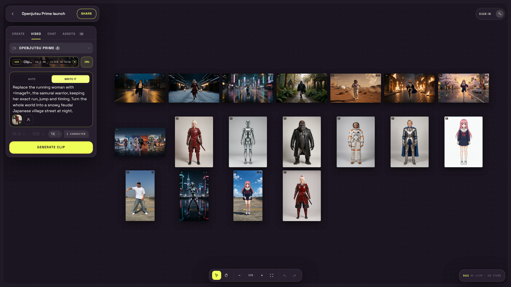
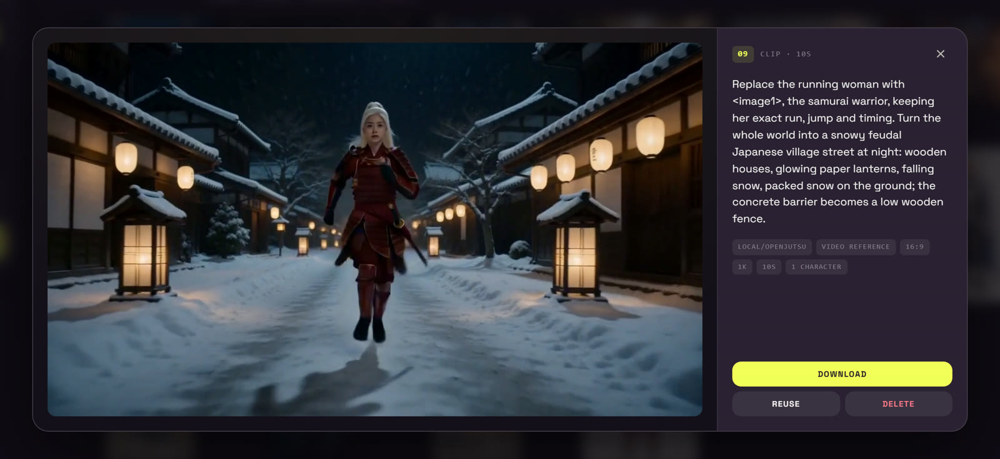

# Openjutsu Prime · Comfy Cinematic


**Openjutsu Prime casts your characters into any video, in any world, on ComfyUI.** Give it one
clip and a character image. It keeps the performance (the run, the jump, the timing, the camera
move and the clip's own sound) and re-shoots the take with your character, in whatever world you
describe. It's an open, MiniMax H3-based take on Higgsfield's Genjutsu, and it runs inside
**Comfy Cinematic**, a project canvas for FLUX 3 stills and MiniMax H3 clips.

**▶ Launch video (57 s): [docs/media/openjutsu-prime-launch.mp4](docs/media/openjutsu-prime-launch.mp4)**

**One take, six worlds.** The same 10-second sprint (made with MiniMax H3 Max), re-shot by
Openjutsu Prime as a samurai in a snowy Edo village, an android in a neon megacity, a gorilla in
jungle ruins, an astronaut on Mars, a knight in a burning castle town, and a 2D anime girl:


The worlds, characters and key art in the launch video and in this README were made in the app,
on this one canvas: the source takes with **MiniMax H3 Max**, the characters and key art with
**FLUX 3**, and every world with **Openjutsu Prime** (Light, 1k). The video's "whole crew" and
"identity" chapters use earlier Openjutsu Prime renders of real dance clips, the latter next to
Genjutsu's take on the same reference.



---

## Openjutsu Prime

### Use it

1. Open the **Video** tab and pick **Openjutsu Prime** (it's the first model in the picker).
2. **Add a video reference**: any clip from 5 to 15 seconds, from your uploads or from the canvas.
   The trim window picks which part of a longer clip to use.
3. **Add a character reference** for each person you want cast (up to 8). A full-body shot on a
   plain background works best, and FLUX 3 on the **Create** tab makes one in a minute.
4. Choose how it's directed:
   - **Auto**: the graph decides who to replace with whom and writes the prompt itself.
   - **Write it**: say what changes, for example *"Replace the running woman with &lt;image1&gt;, the
     samurai. Turn the street into a snowy feudal village at night."* Insert `<image1>`,
     `<image2>`, … from the character chips.
5. Pick **480p** or **1k**, and **Generate clip**. A 10-second clip at 1k took about 11 minutes
   on our deployment. The clip lands on the canvas; open it to see it with the prompt and the
   settings it was made with, or **Reuse** them for the next take.



**It keeps hard identities.** Every reference becomes a clean H3 character sheet before the
render, so unusual features survive: the tall pink hair, the mustache and the velvet suit below
hold up where Genjutsu's take on the same reference drifts.


### What happens in the graph

Openjutsu Prime is a single ComfyUI API graph (`lib/ref5.ts`) that the app builds per render and
runs on your deployment or your own ComfyUI:

1. **Load the clip** with VideoHelperSuite and count its frames. In Light mode with the
   OpenRouter prompt API, a decision model and Gemini's bounding boxes also check one frame for
   screen-recording borders and crop them when both agree.
2. **Character sheets.** Each character image becomes a clean H3 character sheet (an 8-step
   single-frame H3 render), so every reference reaches the video model in the same form.
3. **Prompt model.** A vision model (Comfy Router's Gemini by default, or Kimi on OpenRouter)
   watches the clip and the sheets and writes the H3 prompt: who the subjects are, what replaces
   them, and what must stay. Its answer is pulled out with regexes and checked inside the graph;
   a blank answer is retried once, and a second blank stops the render with a clear error.
4. **Render.** MiniMax H3 reference-to-video, conditioned on the clip (motion, framing and audio)
   and the sheets, in two passes over one latent: the OmniRef model for the first steps, then the
   ref2va model + Pika's LoRA to finish.
5. **Optional 2x upscale** with H3's latent upscaler and the regenerate refiner LoRA.

Two pipelines, set in Openjutsu's gear:

| Mode | What it does |
| --- | --- |
| **Light** (default) | One conditioning on the original clip and your prompt. Fastest. |
| **Quality** | First renders the targeted subjects as chroma-key dummies, then renders your characters over that render. Better separation when several people move together. |

### Settings (the gear on the Openjutsu Prime row)

- **Model name / Clip model name**: the OmniRef diffusion model and the Qwen3-VL text encoder.
- **Mode**: Quality or Light. **Prompt API**: Comfy (Gemini, no extra key) or OR (OpenRouter Kimi,
  with your OpenRouter key).
- **Extras**: the ref2va model, the Pika LoRA, the latent upscaler and the refiner LoRA, already
  filled in with the release names; the **Upscale 2x** switch; and a **Video reference cap**
  (Match output, 288p to 544p) that shrinks the clip H3 encodes, which is most of the render time.
- **Verify** checks that every file exists on the target before you spend a render.

### ComfyUI requirements

Openjutsu runs on a [Comfy deployment](https://docs.comfy.org) or any ComfyUI you can reach.

**Models**

| Folder | File |
| --- | --- |
| `diffusion_models` | `fasth3_omniref_8step_pruned_int8_convrot.safetensors` |
| `diffusion_models` | `minimax_h3_ref2va_pruned_int8_convrot.safetensors` |
| `loras` | `pika_h3_flex_ref2va_v1_bf16.safetensors` |
| `text_encoders` | `qwen3vl_32b_minimax_h3_int8_convrot.safetensors` (or the nvfp4 build) |
| `vae` | `minimax_h3_video_vae_fp16.safetensors`, `minimax_h3_audio_vae_fp32.safetensors` |
| `latent_upscale_models` | `minimax_h3_latent_upscaler_3d_conv_v1_bf16.safetensors` (upscale only) |
| `loras` | `minimax_h3_open_regenerate_2k_refiner_rank_16_bf16.safetensors` or `…rank_384…` (upscale only) |

**Custom nodes**

- ComfyUI core with the MiniMax H3 nodes (`MiniMaxH3ReferenceToVideo`, `MiniMaxH3SigmaShift`,
  `MiniMaxH3LatentUpscaleWithModel`, `BlockSparseAttention`, `ModelAttentionBackend`).
- [ComfyUI-VideoHelperSuite](https://github.com/Kosinkadink/ComfyUI-VideoHelperSuite) for loading
  the clip.
- `ComfyUI-H3-Image`: `H3ImageLatent`, `H3ImageDecode` and `H3WaitForConditioning` for the
  single-frame character sheets.
- `ComfyUI-OpenRouter-Node` and `ComfyUI-Gemini-Spatial`, only for the OpenRouter prompt API and
  the border check.

### A shortcut for reviewers

`/openjutsu-prime?key=YOUR_COMFY_KEY&deployment=https://dep-….run.comfy.app` saves the key and
deployment in the browser, opens a new project on the Video tab with Openjutsu Prime selected, and
drops the key from the address bar.

---

## Comfy Cinematic, the canvas around it

**A project canvas for stills and clips, built on Comfy.** Open a project, describe a frame or a
shot, and the result lands on an infinite canvas you can pan, zoom, drag, undo and share. Render
through Comfy Router, or run the same models on your own ComfyUI or a Comfy deployment.

- **Video**: MiniMax H3 (Original / Max / Turbo on Router, or Local) with **Free**, **Audio
  Reference**, **Video Reference** and **Continue** modes, plus **Openjutsu Prime**.
- **Stills**: FLUX 3 with sixteen aspect ratios, five sizes from 0.75K to 4K, batches of up to
  four, up to four reference images, and an **Edit** mode for images already on the canvas.
- **Assets**: every upload and render in the project, reusable from every reference slot, so a
  still becomes a character and a finished clip becomes the next video reference.
- **The canvas**: frames land on a grid, drag anywhere, undo/redo, and **View**, **Reuse**,
  **Continue**, **Download** or **Delete** any frame.
- **Router or local, one switch**: **Manage account** sends local renders to a Comfy deployment
  (`https://dep-….run.comfy.app`) or to your own ComfyUI (`http://127.0.0.1:8188`).
- **Private by default**: projects, renders and uploads live in your browser (IndexedDB), and your
  Comfy key stays in its `localStorage`.

<p align="center">
  
  &nbsp;
  
</p>

---

## Run it yourself

You need Node 22.6+ and a [Comfy API key](https://platform.comfy.org/profile/api-keys?onboarding=router)
for a workspace with Router access.

```bash
npm ci
cp .env.example .env.local
npm run dev
```

Open <http://127.0.0.1:3000>, click the key icon in the header and paste your Comfy key. For
Openjutsu Prime and the other local models, open **Manage account** and set your deployment or
your ComfyUI address, then press **Verify** in Openjutsu's gear.

### Main settings

| Variable | Purpose |
| --- | --- |
| `COMFY_API_KEY` | Router credential for a self-hosted studio. A key entered in the header wins over it. |
| `COMFY_BASE_URL` | Forces the local render target (e.g. `http://127.0.0.1:8189`), overriding Manage account. |
| `PUBLIC_HOSTING` | Set to `1` on a shared host: the host's keys are never lent to visitors, and render targets must be public addresses. |
| `OPENROUTER_API_KEY` | Only for Openjutsu's OpenRouter prompt API. The key in its gear wins. |
| `H3_REF2VA_UNET` / `H3_REF2VA_LORA` / `H3_LATENT_UPSCALER` | Openjutsu's second-pass and upscale file names, if yours differ. |
| `H3_VAE_VIDEO` / `H3_VAE_AUDIO` / `FLUX_VAE` | VAE file names for the local graphs. |

The full list is in [`.env.example`](.env.example).

### Hosting it for others

The server is stateless, so any Node host works. On a public deployment set `PUBLIC_HOSTING=1`
and leave `COMFY_API_KEY` unset, so every visitor signs in with their own key. Allow long requests:
up to 300 s for a still, 840 s for an H3 clip and 40 minutes for Openjutsu Prime.

### Tests

```bash
npm test
npm run build
```

## License

MIT. See [LICENSE](LICENSE).
