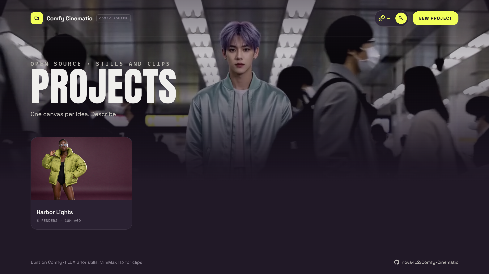
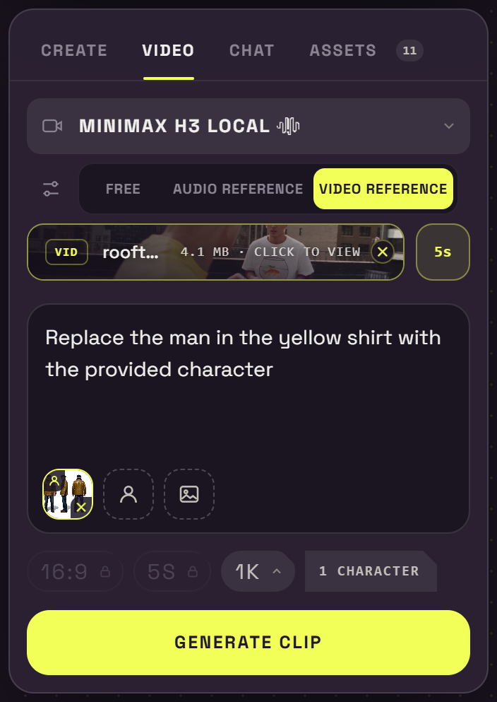
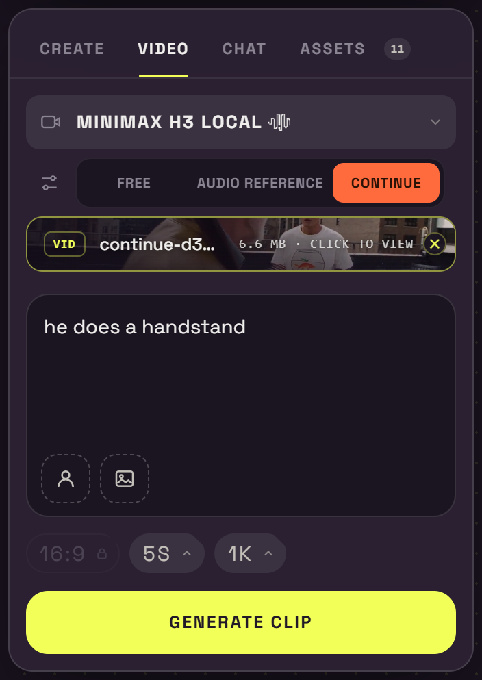
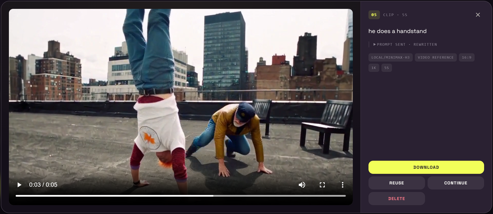
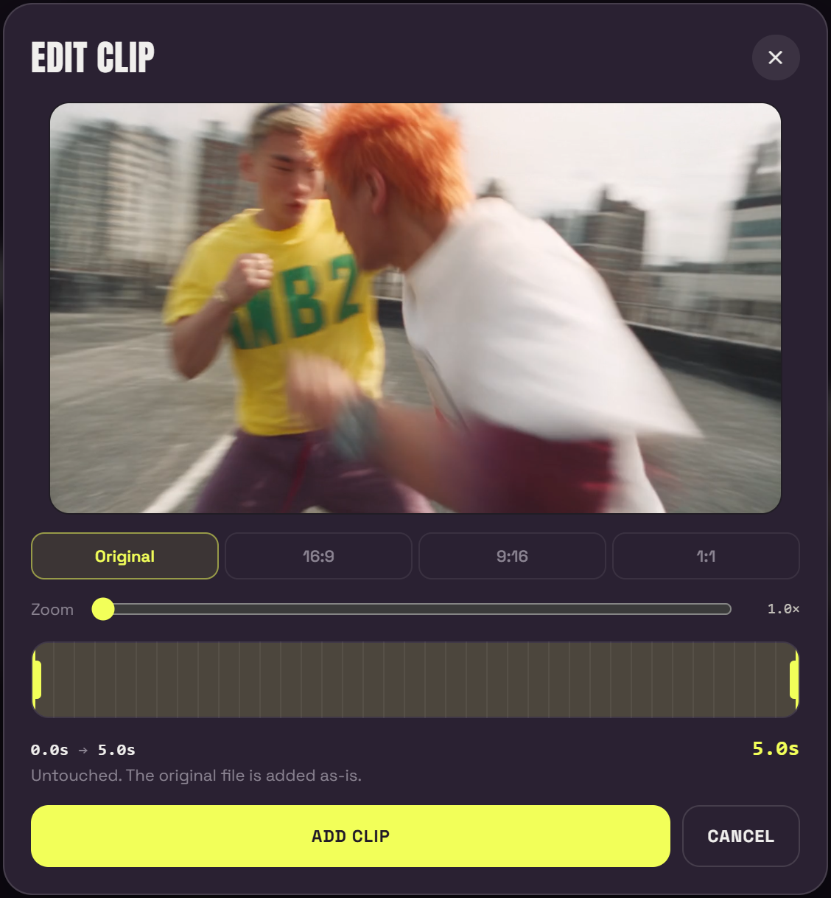
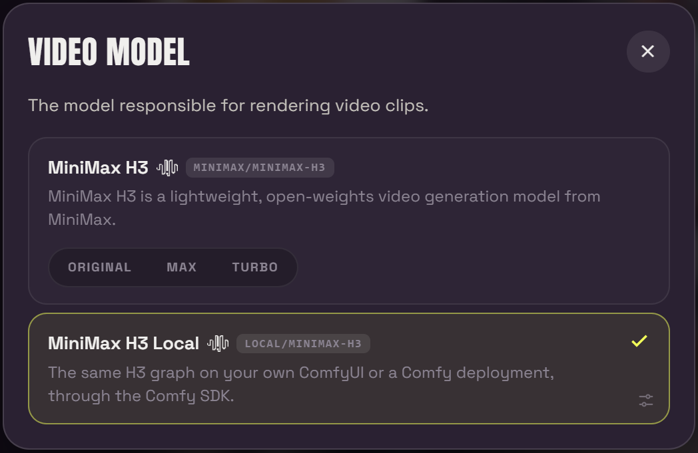
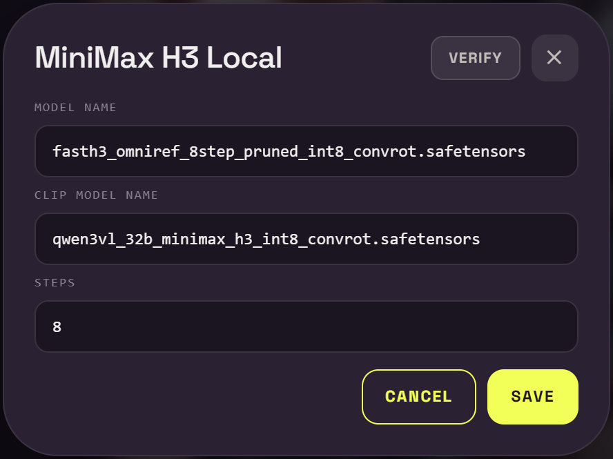
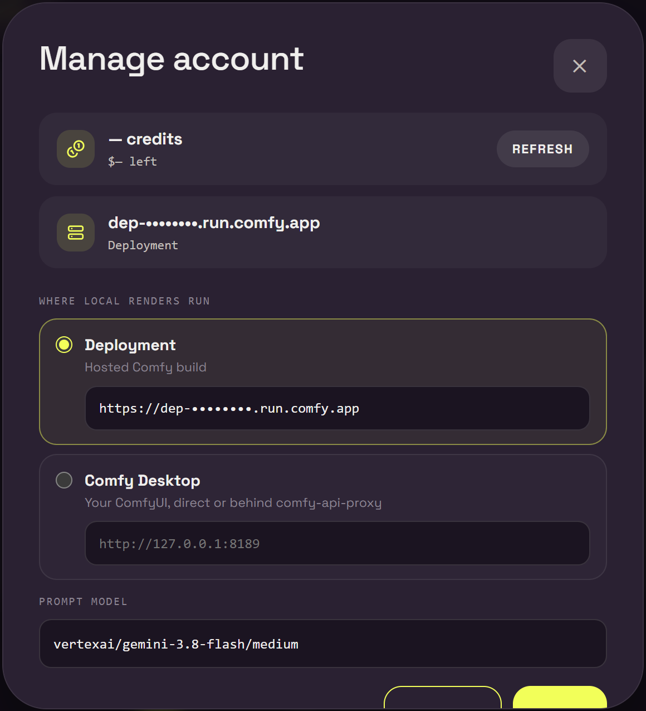
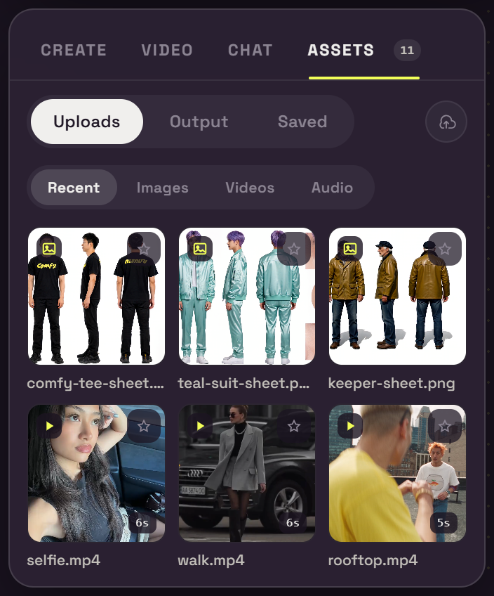
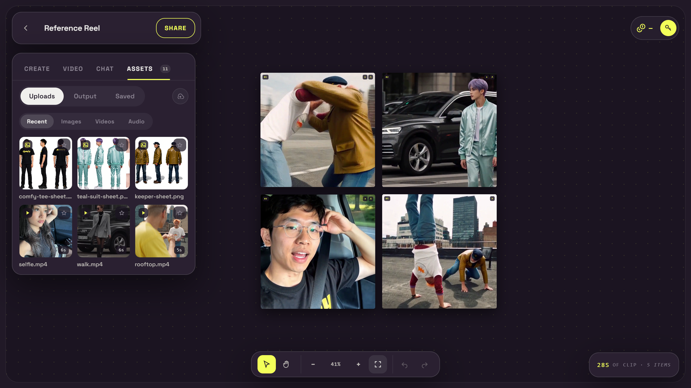

# Comfy Cinematic



**A project canvas for stills and clips, built on Comfy.** Open a project, describe a frame or a
shot, and the result lands on an infinite canvas you can pan, zoom, drag, undo and share. Render
through Comfy Router, or run the same models on your own ComfyUI or a Comfy deployment.

**▶ Live demo: [comfy-cinematic.ai.studio](https://comfy-cinematic.ai.studio/)**

Sign in with your own Comfy API key (top right), make a project, and go.

---

## What it does

### Video, four ways

The **Video** tab renders clips with **MiniMax H3**, either on Router or as **MiniMax H3 Local**.

| Mode | You give it | You get |
| --- | --- | --- |
| **Free** | A prompt, plus an optional first and last frame | A clip that starts (and ends) where you said |
| **Audio Reference** | A track | A clip cut to that audio, with the track as its soundtrack |
| **Video Reference** | A clip, plus character and background references | The same motion and framing, recast |
| **Continue** | Any clip on the canvas | The next shot, picking up from its last frames |

<p align="center">
  
  &nbsp;
  
</p>

- **Video Reference + character sheets.** Drop in a reference clip, add a character sheet, and say
  who to replace: *"Replace the man in the yellow shirt with the provided character."* The fight,
  the walk or the selfie keeps its moves and its camera, and the person is swapped out.
- **Continue.** Press Continue on any clip (on the canvas or in the viewer), type what happens next,
  for example *"he does a handstand"*, and render. The clip's prompt, model and timing are carried
  over, and H3 sees the run-up to the cut so the new shot follows on from it.

  
- **Edit before you use it.** Uploaded clips open in an **Edit clip** panel (trim, crop to 16:9,
  9:16 or 1:1, zoom and reframe). Reference length is set by a **Trim** window snapped to whole
  seconds (5–15s for H3).

  
- **The reference's sound is kept.** Video and audio references carry their own audio into the
  finished clip. A free render gets H3's generated soundtrack.

### Router or local, one switch

Every model has a Router entry and a **Local** entry side by side in its picker:

- **FLUX 3** / **FLUX 3 Local** for stills, and **MiniMax H3** (Original / Max / Turbo) /
  **MiniMax H3 Local** for clips.
- Local renders go to whichever target is selected in **Manage account**:
  - **Deployment**: a hosted Comfy build (`https://dep-….run.comfy.app`), using your Comfy key.
  - **Comfy Desktop**: your own ComfyUI, directly (`http://127.0.0.1:8188`) or behind
    `comfy-api-proxy`.
- The **gear** on a Local row sets the diffusion model, text encoder and step count, and **Verify**
  checks those files exist on the target before you spend a render.
- Local renders on your own machine cost no credits. Router renders, and jobs on a hosted
  deployment, are billed to your Comfy workspace.

<p align="center">
  
  &nbsp;
  
</p>
<p align="center">
  
</p>

### Stills

FLUX 3 with sixteen aspect ratios, five size classes from 0.75K to 4K, batches of up to four,
up to four reference images, and an **Edit** mode that reworks an image already on the canvas.

### Assets

The **Assets** tab is every upload and every render in the project in one library:

- **Uploads**, **Output** and **Saved** (starred) tabs.
- **Recent / Images / Videos / Audio** filters.
- Click any tile to see it full size. The same library opens from every reference slot, so a still
  on the canvas can become a first frame and a finished clip can become the next video reference.

<p align="center">
  
  &nbsp;
  
</p>

### Projects

One canvas per idea. The home page lists your projects, each with its first render as the cover,
a render count and when you last worked on it. **New project** takes you straight to an empty
canvas, with nothing to set up first.


### The canvas



- Frames lay out on a grid as they land. Drag them anywhere, and undo/redo everything.
- A render claims its slot before the request goes out, shown as a blueprint square with the prompt.
  Drag it, and the result lands where you left it.
- Select a frame to **View**, **Reuse** (put its exact settings back in the panel), **Continue**,
  **Download** or **Delete**.
- The viewer shows a clip or portrait still at its own shape, with the prompt you typed and the
  settings it was made with.
- **Chat**: ask a question instead of describing a frame, and it answers in the Chat tab.

### Private by default

Projects, renders and uploads never reach the server: they live in your browser (IndexedDB), and
your Comfy key stays in its `localStorage`. Clearing the site's data deletes your projects, so
download anything you want to keep.

---

## Run it yourself

You need Node 22.6+ and a [Comfy API key](https://platform.comfy.org/profile/api-keys?onboarding=router)
for a workspace with Router access.

```bash
npm ci
cp .env.example .env.local
npm run dev
```

Open <http://127.0.0.1:3000> and sign in from the header. Or put the key in `COMFY_API_KEY` for a
self-hosted studio. For local renders, open **Manage account** and point it at your deployment or
your ComfyUI.

### Main settings

| Variable | Purpose |
| --- | --- |
| `COMFY_API_KEY` | Router credential for a self-hosted studio. A key entered in the header wins over it. |
| `COMFY_BASE_URL` | Forces the local render target (e.g. `http://127.0.0.1:8189`), overriding Manage account. |
| `PUBLIC_HOSTING` | Set to `1` on a shared host: the host's keys are never lent to visitors, and render targets must be public addresses. |
| `H3_VAE_VIDEO` / `H3_VAE_AUDIO` / `FLUX_VAE` | VAE file names for the local graphs. |

The full list is in [`.env.example`](.env.example) and [README-LONG.md](README-LONG.md#environment).

### Hosting it for others

The server is stateless, so any Node host works. On a public deployment (like the demo), set
`PUBLIC_HOSTING=1` and leave `COMFY_API_KEY` unset, so every visitor signs in and pays with their
own key. "Comfy Desktop" there would mean the *server's* `127.0.0.1`, so visitors should use a
hosted deployment, or a public tunnel to their own ComfyUI, for local renders. Allow long requests:
up to 300s for a still and 840s for a clip.

### Tests

```bash
npm test
npm run build
```

---

## Documentation

The full guide covers the design language, the prompt rewrite for reference modes, the local
H3 and FLUX graphs, every environment variable and the code layout. It's in
[README-LONG.md](README-LONG.md).

## License

MIT. See [LICENSE](LICENSE).
