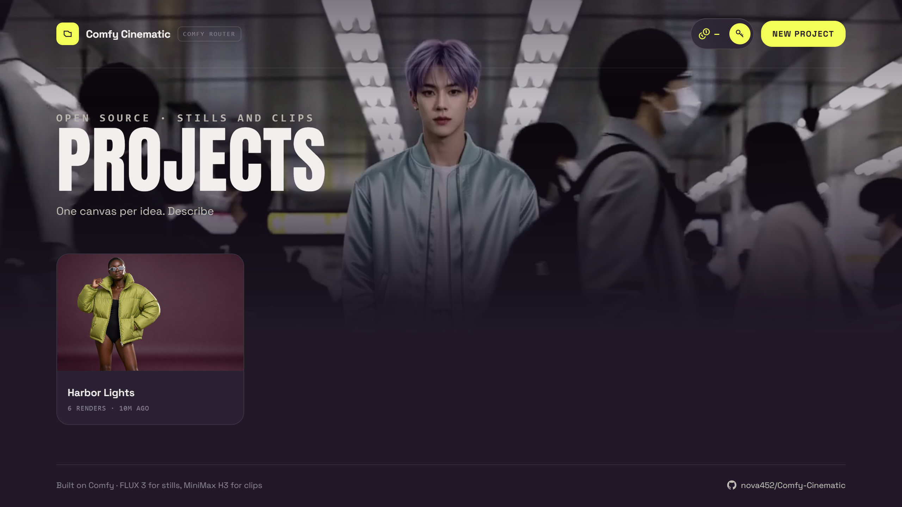
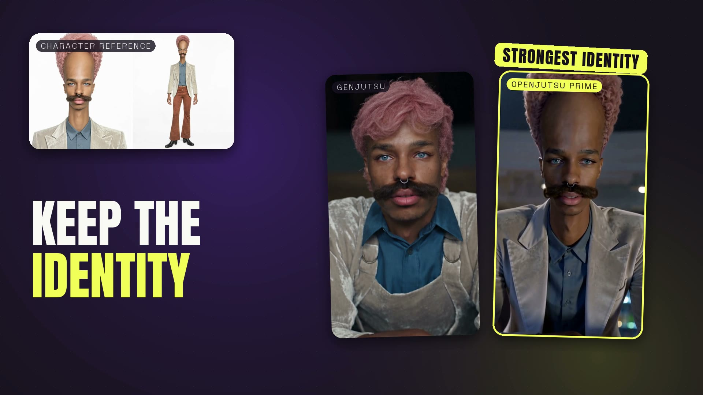
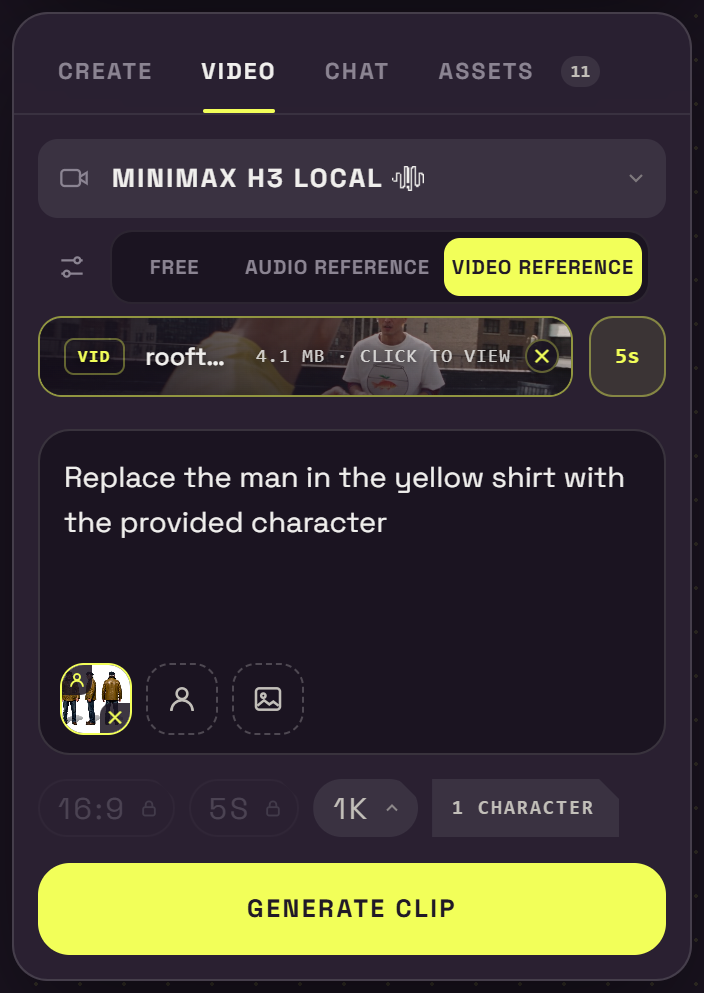
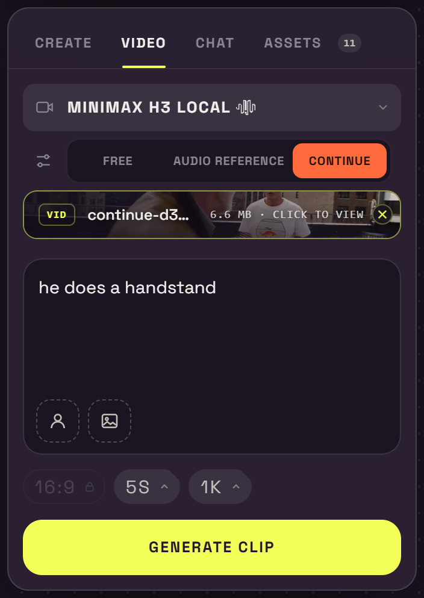
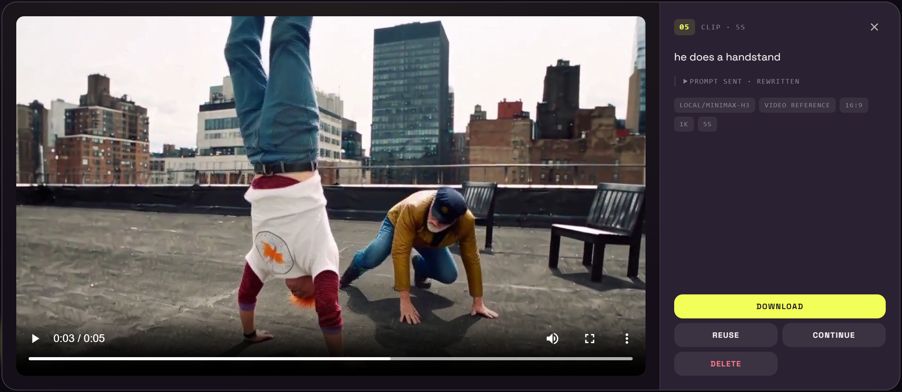
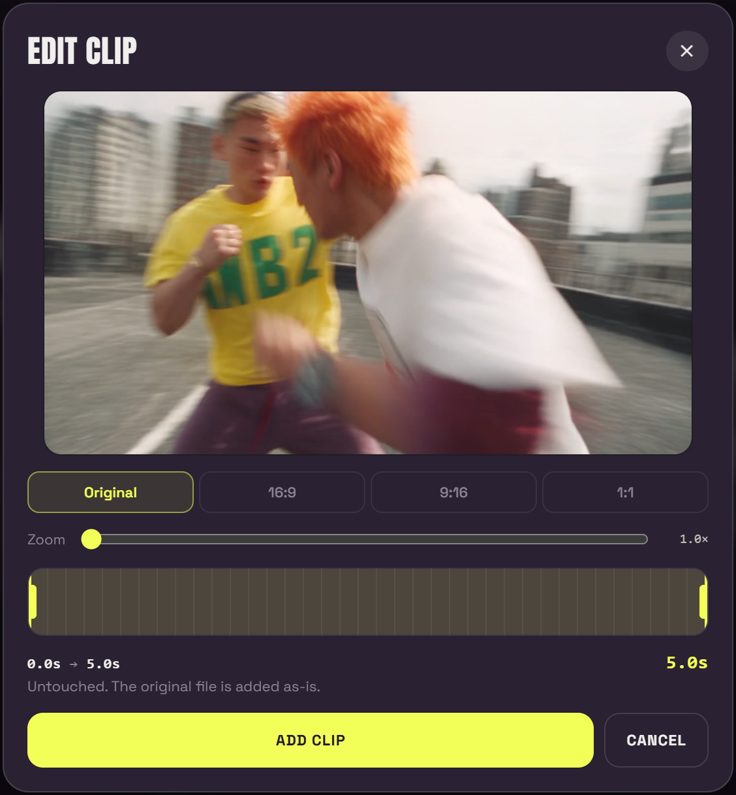
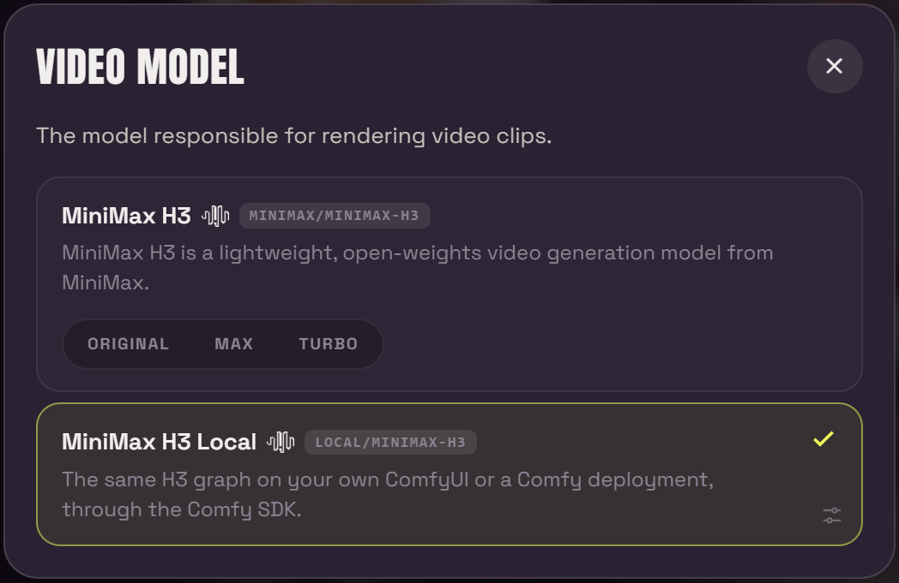
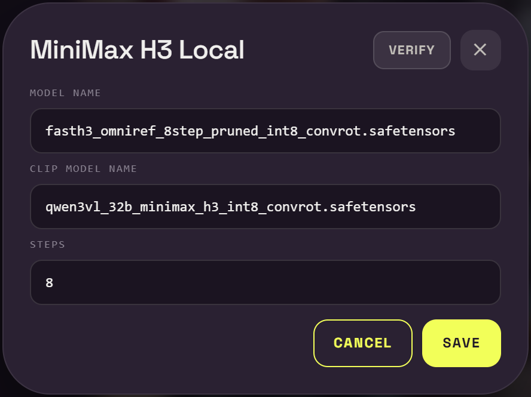
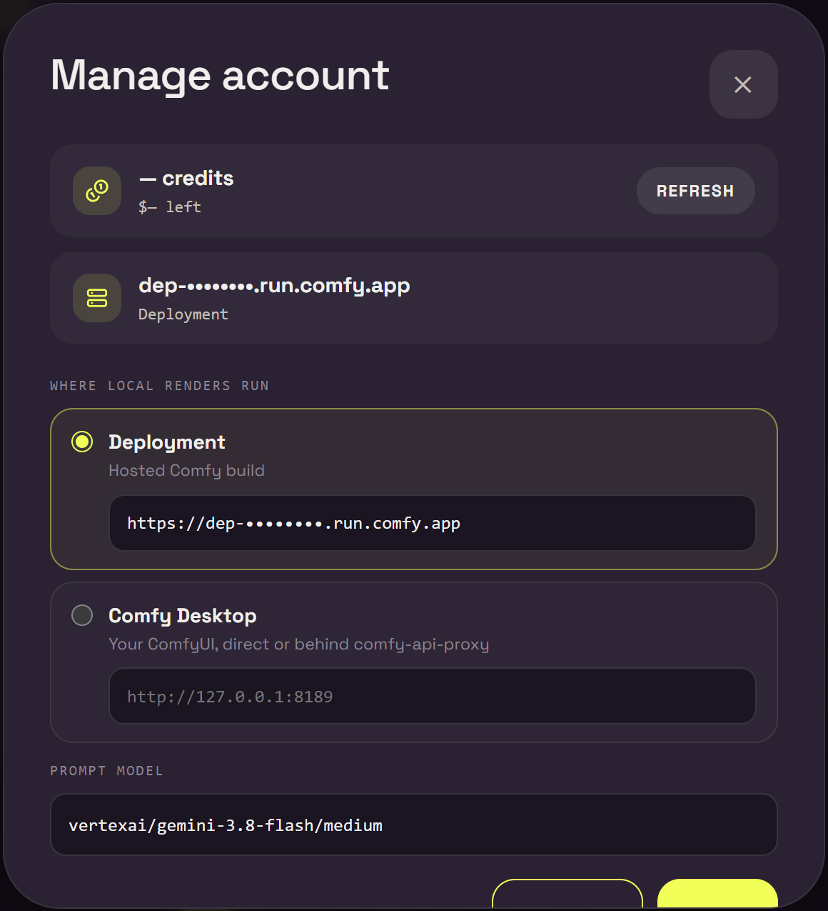
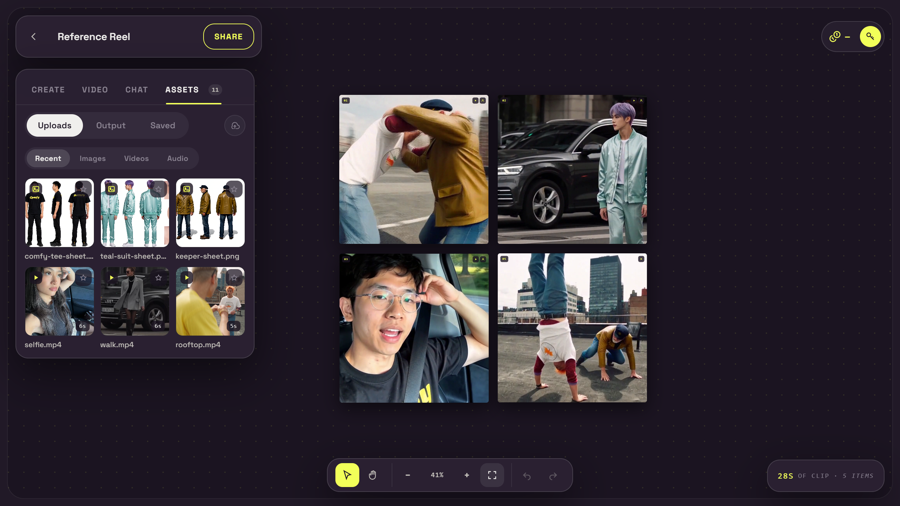

# Comfy Cinematic



**A project canvas for stills and clips, built on Comfy.** Open a project, describe a frame or a
shot, and a canvas you can pan, zoom, drag, undo and share. Render
through Comfy Router, or run the same models on your own ComfyUI or a Comfy deployment.

**▶ Try it: [comfy-cinematic.ai.studio](https://comfy-cinematic.ai.studio/)**

**▶ Video: [X](https://x.com/Enchant62923386/status/2117547679366733991)**

---

## What it does

### Openjutsu Prime

Pick **Openjutsu Prime** on the **Video** tab, add a clip (5–15 s) and a character image for each
person you want cast, and either press **Auto** or write it: *"Replace the running woman with
&lt;image1&gt;. Turn the street into a snowy feudal village at night."* The six worlds in the
[demo video](https://x.com/Enchant62923386/status/2117547679366733991) were made this way, in one project: the source
take with MiniMax H3 Max, the characters with FLUX 3, and each world with Openjutsu Prime. A
10-second clip at 1k takes about 11 minutes on a Comfy deployment.

- **Keeps the identity.** Weird faces, wild hair and a mustache, where Genjutsu's take on the
  same reference drifts.

  
- **Two modes**, set in its gear: **Light** (the default) conditions on the original clip and your
  prompt; **Quality** first renders the targeted subjects as chroma-key dummies, then your
  characters over that render, for better separation when several people move together.

### Video, four ways

The **Video** tab renders clips with **MiniMax H3**, either on Router or as **MiniMax H3 Local**.

| Mode | You give it | You get |
| --- | --- | --- |
| **Free** | A prompt, plus an optional first and last frame | A clip that starts (and ends) where you said |
| **Audio Reference** | A track | A clip cut to that audio, with the track as its soundtrack |
| **Video Reference** | A clip, plus character and background references | The same motion and framing, recast |
| **Continue** | Any MiniMax H3 clip on the canvas | The next shot, picking up from its last frames |

<p align="center">
  
  &nbsp;
  
</p>


- Motion reference, Object swap, clip looping and more


- **Video Reference + character sheets.** Drop in a reference clip, add a character sheet, and say
  who to replace: *"Replace the man in the yellow shirt with the provided character."* The fight,
  the walk or the selfie keeps its moves and its camera, and the person is swapped out.
- **Continue.** Press Continue on any MiniMax H3 clip (on the canvas or in the viewer), type what happens next,
  for example *"he does a handstand"*, and render. The clip's prompt, model and timing are carried
  over, and H3 sees the run-up to the cut so the new shot follows on from it. Openjutsu clips are not
  offered it: the ref5 graph casts characters into a clip rather than extending one.

  
- **Edit before you use it.** Uploaded clips open in an **Edit clip** panel (trim, crop to 16:9,
  9:16 or 1:1, zoom and reframe). Reference length is set by a **Trim** window snapped to whole
  seconds (5–15s for H3).

  
- **The reference's sound is kept.** Video and audio references carry their own audio into the
  finished clip. A free render gets H3's generated soundtrack.

### Router or local, one switch

Every model has a Router entry and a **Local** entry side by side in its picker:

- **FLUX 3** / **FLUX 3 Local** for stills, and **MiniMax H3** (Original / Max / Turbo) /
  **MiniMax H3 Local** for clips.
- Local renders go to whichever target is selected in **Manage account**:
  - **Deployment**: a hosted Comfy build (`https://dep-….run.comfy.app`), using your Comfy key.
  - **Comfy Desktop**: your own ComfyUI, directly (`http://127.0.0.1:8188`) or behind
    `comfy-api-proxy`.
- The **gear** on a Local row opens that row's own settings — model files, steps and, for
  Openjutsu, the OpenRouter key its graph calls — and **Verify** checks those files exist on the
  target before you spend a render. MiniMax H3 Local and Openjutsu keep separate settings.
- Local renders on your own machine cost no credits. Router renders, and jobs on a hosted
  deployment, are billed to your Comfy workspace.

<p align="center">
  
  &nbsp;
  
</p>
<p align="center">
  
</p>

### Stills

FLUX 3 with sixteen aspect ratios, five size classes from 0.75K to 4K, batches of up to four,
up to four reference images, and an **Edit** mode that reworks an image already on the canvas.

### Assets

The **Assets** tab is every upload and every render in the project in one library:

- **Uploads**, **Output** and **Saved** (starred) tabs.
- **Recent / Images / Videos / Audio** filters.
- Click any tile to see it full size. The same library opens from every reference slot, so a still
  on the canvas can become a first frame and a finished clip can become the next video reference.



### Private by default

Projects, renders and uploads never reach the server: they live in your browser (IndexedDB), and
your Comfy key stays in its `localStorage`. Clearing the site's data deletes your projects, so
download anything you want to keep.

---

### Required resources

Only needed for the **Local** models and Openjutsu Prime; Router models need just the key.

**Models**

| Folder | File | Used by |
| --- | --- | --- |
| `diffusion_models` | `fasth3_omniref_8step_pruned_int8_convrot.safetensors` | H3 Local, Openjutsu Prime |
| `diffusion_models` | `minimax_h3_ref2va_pruned_int8_convrot.safetensors` | Openjutsu Prime |
| `diffusion_models` | `flux3-image-klein-int8-convrot0.safetensors` | FLUX 3 Local |
| `loras` | `pika_h3_flex_ref2va_v1_bf16.safetensors` | Openjutsu Prime |
| `loras` | `minimax_h3_open_regenerate_2k_refiner_rank_16_bf16.safetensors` (or `…rank_384…`) | Openjutsu Prime, upscale only |
| `text_encoders` | `qwen3vl_32b_minimax_h3_nvfp4_awq.safetensors` (or the `int8_convrot` build) | H3 Local, Openjutsu Prime |
| `text_encoders` | `qwen3vl_4b_fp8_scaled.safetensors` | FLUX 3 Local |
| `vae` | `minimax_h3_video_vae_fp16.safetensors`, `minimax_h3_audio_vae_fp32.safetensors` | H3 Local, Openjutsu Prime |
| `vae` | `flux2-vae.safetensors` | FLUX 3 Local |
| `latent_upscale_models` | `minimax_h3_latent_upscaler_3d_conv_v1_bf16.safetensors` | Openjutsu Prime, upscale only |

File names can be changed in each model's gear (and its **Extras**), and **Verify** checks them on
your target.

**Custom nodes**
Grab them at [main/Packaged Nodes](https://github.com/nova452/Comfy-Cinematic/tree/main/Packaged%20nodes)

## Run it yourself

```bash
npm ci
cp .env.example .env.local
npm run dev
```

### Hosting it for others

The server is stateless, so any Node host works. On a public deployment (like the demo), set
`PUBLIC_HOSTING=1` and leave `COMFY_API_KEY` unset, so every visitor signs in and pays with their
own key. "Comfy Desktop" there would mean the *server's* `127.0.0.1`, so visitors should use a
hosted deployment, or a public tunnel to their own ComfyUI, for local renders. Allow long requests:
up to 300s for a still and 840s for a clip.

### Tests

```bash
npm test
npm run build
```

## License

MIT. See [LICENSE](LICENSE).
